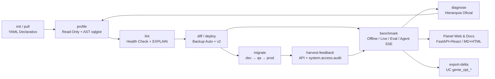

# Databricks GenieOps — Framework Genie-as-Code

Toolkit reutilizável de **Genie-as-Code** para criar, curar, auditar, testar, diagnosticar, observar, documentar e promover **Databricks Genie Spaces / Genie Agents** em múltiplos workspaces e ambientes (`dev` / `qa` / `prod`), tanto localmente no terminal e no **Painel Web Local** quanto em pipelines CI/CD.

> **Decisões de Negócio & Arquitetura ("Por Quês"):** consulte [docs/DECISOES_E_ARQUITETURA.md](docs/DECISOES_E_ARQUITETURA.md) para os 10 ADRs detalhando o racional de negócio, segurança, avaliação e conformidade oficial com Databricks Genie Agents.

---

## Por que o Databricks GenieOps existe?

Gerenciar Genie Spaces diretamente na UI funciona para protótipos, mas quebra em escala corporativa: não há code review, o `update-space` sobrescreve tudo sem rollback, alterações geram regressões silenciosas, promoções `dev → qa → prod` são manuais e equipes tendem a sobrecarregar `text_instructions` com regras frágeis.

O **Databricks GenieOps** resolve isso trazendo práticas modernas de Engenharia de Software e DataOps para Genie Agents:

- **Declarativo & Determinístico:** 4 arquivos YAML legíveis por Space (`space.yaml`, `sources.yaml`, `instructions.yaml`, `benchmarks.yaml`) compilados com UUID5 e ordenação estável para o payload oficial **`serialized_space` v2** — zero ruído em `git diff`.
- **Qualidade Automatizada (Genie Health Check):** linter estático com Health Score (`0–100`), detecção de colunas nuas em `join_specs`/`sql_snippets`, validação de Metric Views (`MEASURE()`), bloqueio de **Benchmark Leakage** e validação real via `EXPLAIN` read-only.
- **Benchmarks Confiáveis (4 Modos):** `offline` (CI custo zero), `live` (Conversation API + **equivalência matemática de Result Sets**), `eval-run` (wrapper nativo Databricks com staged gates) e `agent` (**Streaming SSE da Agent Mode API** + **LLM-as-a-Judge plugável**).
- **Diagnóstico pela Hierarquia Oficial Databricks:** classifica a causa raiz das falhas e propõe a correção na **menor superfície estruturada** (metadados → `column_configs` → `entity_matching` → Metric View → `join_specs` → `sql_snippets` → exemplos → `text_instructions` só por último), sem auto-mutar o Space.
- **Curadoria Assistida por Dados Reais:** Data Profiling read-only + **AST Profiling (`sqlglot`)** em `system.query.history` + coleta de feedback negativo com `system.access.audit` e deduplicação semântica.
- **Observabilidade & Governança Corporativa:** histórico local em SQLite WAL (regressão + latência P50/P95), **Painel Web Local** (FastAPI + React/Vite/Tailwind) e exportação opcional para as tabelas Delta oficiais Databricks (`genie_opt_*`) no Unity Catalog.
- **Segurança Inegociável:** zero segredos hardcoded (apenas perfis Databricks CLI / variáveis de ambiente), guarda estrita `assert_read_only_sql` para toda consulta de análise e backup automático pré-`update-space`.

---

## Ciclo de Vida & Arquitetura



### Estrutura do Repositório

```text
databricks-genie-ops/
├── genieops/                        # Core Python 3.12+ (CLI Typer/Rich + motores)
│   ├── cli.py                       # Interface de linha de comando (15 comandos)
│   ├── models.py                    # Modelos Pydantic v2 (SpaceBundle e YAML schemas)
│   ├── loader.py                    # Leitura, escrita, scaffold e resolução multi-env
│   ├── compiler.py                  # Compilador determinístico serialized_space v2 + pull reverso
│   ├── migrator.py                  # Remapeamento catalog/schema/Volumes entre dev/qa/prod
│   ├── databricks_client.py         # Wrapper Databricks CLI + guarda estrita SQL read-only
│   ├── deployer.py                  # Diff remoto + create/update-space com backup automático
│   ├── linter.py                    # Genie Health Check (regras estáticas + EXPLAIN SQL)
│   ├── comparator.py                # Equivalência matemática de Result Sets com tolerância
│   ├── benchmark.py                 # Motor de benchmark (offline, live, eval-run, agent)
│   ├── agent_mode.py                # Cliente streaming SSE da Agent Mode API (STANDARD/FLASH)
│   ├── judges.py                    # LLM-as-a-Judge plugável (heuristic, databricks, openai)
│   ├── history.py                   # Persistência SQLite WAL + regressão + P50/P95
│   ├── diagnoser.py                 # Causa raiz + hierarquia oficial de correção Databricks
│   ├── profiler.py                  # Profiling read-only (schema, cardinalidade, sugestões YAML)
│   ├── ast_profiler.py              # Parsing AST (sqlglot) em system.query.history
│   ├── harvester.py                 # Coleta de feedback (API + system.access.audit + dedup)
│   ├── uc_export.py                 # Exportação Delta UC (genie_opt_* com guarda allowlist)
│   ├── docs_generator.py            # Gerador Jinja2 (MD executivo/técnico/usuário + HTML)
│   └── web_api.py                   # API REST + SSE FastAPI para o Painel Web Local
├── web/                             # Painel Web Local (React 19 + TypeScript + Vite + Tailwind v4)
├── spaces/
│   └── exemplo_vendas/              # Template corporativo completo (2 tabelas, 1 Metric View, 1 Volume, 22 benchmarks)
├── env/                             # Defaults por ambiente (dev.yaml, qa.yaml, prod.yaml)
├── templates/                       # Templates Jinja2 de documentação automática
├── docs/
│   └── DECISOES_E_ARQUITETURA.md    # ADRs e decisões de negócio / por quês do framework
├── .agents/rules/                   # Regras contextuais de governança de agentes (Antigravity)
├── GEMINI.md                        # Regras permanentes de arquitetura, segurança e qualidade
├── tests/                           # 33 testes unitários pytest (100% offline com mocks)
└── .github/workflows/genie_ci.yml   # Pipeline CI (pytest + lint + benchmark offline + docs + determinismo)
```

---

## Instalação Rápida

### Pré-requisitos
- **Python 3.11+** (recomendado 3.12+)
- **Node.js 20+** (opcional — apenas para compilar/desenvolver o frontend em `web/`)
- **Databricks CLI `>= v1.0.0`** (apenas para comandos conectados a workspaces reais, autenticado via `databricks auth login --profile <perfil>`)

### Setup do Backend & CLI

```powershell
# Clonar e criar ambiente virtual
git clone https://github.com/vitorh-nascimento/databricks-genie-ops.git
cd databricks-genie-ops
python -m venv .venv
.venv\Scripts\activate
pip install -e ".[dev]"

# Validar instalação e rodar toda a suíte de testes (33 testes)
genieops version
pytest -v
ruff check genieops tests
```

### Build do Painel Web Local (React + Vite + Tailwind)

```powershell
cd web
npm.cmd install
npm.cmd run build
cd ..

# Iniciar o Painel Web Local em http://genieops.localhost:8765 (ou usar .\start.ps1)
genieops serve
# ou com launcher dedicado (Single-Server ou -Dev na porta 5765):
.\start.ps1
.\start.ps1 -Dev
```

> Em sistemas Linux/macOS, use `npm install` e `npm run build`. No PowerShell Windows, `npm.cmd` evita bloqueios de `ExecutionPolicy`.

---

## Teste Imediato com o Template `exemplo_vendas` (Sem Precisar de Workspace)

O repositório já inclui um Space corporativo completo (`spaces/exemplo_vendas/`) com Health Score **99/100** e **100%** no benchmark offline:

```powershell
# Listar spaces registrados
genieops list

# Executar Genie Health Check em modo estrito
genieops lint exemplo_vendas --strict

# Rodar benchmark offline (salva no .genieops/history.db)
genieops benchmark exemplo_vendas --env dev --mode offline

# Gerar documentação técnica, executiva (MD/HTML) e guia do usuário
genieops docs exemplo_vendas

# Compilar payload determinístico v2 remapeado para produção
genieops compile exemplo_vendas --env prod --output .genieops/staging/exemplo_vendas_prod.json

# Gerar preview SQL de exportação Delta para Unity Catalog (dry-run seguro)
genieops export-delta exemplo_vendas --catalog analytics_ops --schema genieops_audit

# Abrir o Painel Web Local em http://127.0.0.1:8765
genieops serve
```

---

## Referência Completa de Comandos CLI

| Etapa | Comando | Finalidade |
| :--- | :--- | :--- |
| **Listar** | `genieops list` | Lista todos os Genie Spaces declarados em `spaces/` com contagem de fontes, benchmarks e ambientes. |
| **Criar Scaffold** | `genieops init <nome> --catalog <cat> --schema <sch>` | Cria scaffold declarativo completo (`space.yaml`, `sources.yaml`, `instructions.yaml`, `benchmarks.yaml`). |
| **Importar Remoto** | `genieops pull <space_id> --profile <perfil> --name <nome>` | Importa um Genie Space existente do Databricks (`get-space`) e converte para YAML declarativo. |
| **Profiling + AST** | `genieops profile <nome> --env dev [--query-history]` | Analisa metadados/cardinalidade e executa parsing AST (`sqlglot`) em `system.query.history` sugerindo `entity_matching`, `exclude`, `join_specs`, filtros e medidas. |
| **Health Check** | `genieops lint <nome> [--validate-sql --env dev] [--strict]` | Audita boas práticas (fontes, `column_configs`, qualificação SQL, Metric Views, Benchmark Leakage, `text_instructions`, limites v2 e `EXPLAIN` opcional). |
| **Compilar v2** | `genieops compile <nome> [--env prod] [-o arquivo.json]` | Compila os 4 YAMLs para o JSON determinístico oficial `serialized_space` v2. |
| **Diff Remoto** | `genieops diff <nome> --env dev [--profile <p>]` | Compara payload local compilado com o estado atual do Genie Space no Databricks. |
| **Deploy Seguro** | `genieops deploy <nome> --env dev [--dry-run] [--persist-id]` | Valida com linter, salva backup automático para rollback e aplica `create-space` ou `update-space`. |
| **Benchmark** | `genieops benchmark <nome> --env dev --mode <offline\|live\|eval-run\|agent>` | Avalia assertividade, equivalência de Result Sets, latência P50/P95, regressão vs rodada anterior e suporte a `--ids`, `--only-failed`, `--execution-mode STANDARD\|FLASH` e `--judge heuristic\|databricks\|openai`. |
| **Diagnóstico** | `genieops diagnose <nome> [--run-id <id>]` | Classifica causa raiz das falhas e propõe plano de correção seguindo a hierarquia oficial Databricks (somente leitura; requer aprovação manual). |
| **Coleta Feedback** | `genieops harvest-feedback <nome> --env prod [--include-audit --days 30]` | Extrai perguntas com falha/feedback negativo (API + `system.access.audit`) com deduplicação semântica para `benchmarks_draft.yaml`. |
| **Documentação** | `genieops docs <nome> [-o dir]` | Gera automaticamente `SPEC_TECNICA.md`, `RELATORIO_EXECUTIVO.md`, `relatorio_executivo.html` e `GUIA_USUARIO.md`. |
| **Promoção Multi-Env** | `genieops migrate <nome> --from dev --to prod [--deploy]` | Remapeia `catalog`, `schema` e `/Volumes/...` em todas as superfícies e promove entre workspaces. |
| **Exportação Delta** | `genieops export-delta <nome> --catalog <cat> --schema <sch> [--schema-mode four_tables\|events] [--execute]` | Gera DDL + `MERGE INTO` idempotente para tabelas Delta oficiais (`genie_opt_*`) no Unity Catalog. Dry-run por padrão; exige `--execute` para aplicar. |
| **Painel Web Local** | `genieops serve [--host 127.0.0.1] [--port 8765] [--no-browser]` | Inicia o servidor FastAPI servindo a API REST/SSE e o frontend React/Vite/Tailwind. |

---

## Painel Web Local (`genieops serve` / `.\start.ps1`)

O dashboard local roda por padrão em **`http://genieops.localhost:8765`** (e modo dev Vite na porta dedicada **`5765`** via `.\start.ps1 -Dev`), isolando origem/cookies e evitando conflitos com portas comuns (`8000`, `8080`, `8185`, `5173`, `5185`, `3000`). Oferece 5 visões integradas:

1. **Health Check & Fontes:** Health Score consolidado, filtro por severidade (`ERROR`/`WARNING`/`INFO`), recomendações acionáveis e inventário de tabelas, Metric Views e UC Volumes.
2. **Benchmarks & Regressões:** gráfico SVG de tendência histórica de assertividade (com meta >= 90%), execução de benchmark offline com 1 clique, badges de regressão (`FIXED` / `REGRESSED`) e detalhamento por pergunta.
3. **Diagnóstico (Causa Raiz):** cards de causa raiz com nível de confiança, alavanca estruturada recomendada, antipadrões a evitar e referência fixa da hierarquia oficial de 8 camadas.
4. **Agent Mode SSE + LLM-as-a-Judge:** playground de streaming Server-Sent Events exibindo em tempo real `response.created`, `reasoning`, `execute_sql`, `search_context_files`, `response.completed` e o veredito do juiz plugável (modo preview local seguro ou modo conectado ao Databricks real).
5. **Exportação Delta (UC):** gerador interativo de SQL (`four_tables` vs `events`) com cópia rápida para execução ou revisão em PR.

---

## Segurança, Variáveis de Ambiente e Governança

- **Zero segredos versionados:** consulte [.env.example](.env.example). Credenciais Databricks são resolvidas via perfis CLI (`databricks auth login --profile <perfil>`) ou OAuth M2M em CI/CD.
- **LLM-as-a-Judge configurável por ambiente:**
  - `heuristic`: determinístico e offline (padrão seguro para CI).
  - `databricks`: chama Foundation Model API / Unity Gateway via perfil Databricks CLI (`GENIEOPS_JUDGE_ENDPOINT`).
  - `openai`: chama qualquer endpoint OpenAI-compatible (`GENIEOPS_JUDGE_BASE_URL`, `GENIEOPS_JUDGE_API_KEY`, `GENIEOPS_JUDGE_MODEL`).
- **Guarda Read-Only & Allowlist UC:** toda consulta de profiling, validação e auditoria é validada por `assert_read_only_sql`. A escrita de histórico Delta exige `--execute` explícito e só permite operações nas tabelas `genie_opt_*` do `catalog.schema` informado.
- **Governança de Agentes:** regras do repositório estão versionadas em [GEMINI.md](GEMINI.md) e [.agents/rules/](.agents/rules/).

---

## CI/CD & Portão de Qualidade

O workflow [.github/workflows/genie_ci.yml](.github/workflows/genie_ci.yml) valida automaticamente a cada Pull Request e push na `main`:
1. Suíte completa de testes unitários (`pytest -v` — **33/33 testes** 100% offline com mocks de CLI, HTTP/SSE e FastAPI `TestClient`).
2. Qualidade de código (`ruff check genieops tests`).
3. `genieops lint <space> --strict` em todos os spaces de `spaces/`.
4. `genieops benchmark <space> --env dev --mode offline`.
5. Geração de documentação (`genieops docs`) e verificação de determinismo byte-a-byte do compilador `serialized_space` v2.

---

## Checklist de Prontidão para Produção

- [ ] `genieops lint <space> --validate-sql --env prod --strict` com **0 erros** e **Health Score >= 85/100**.
- [ ] Fontes focadas (`<= 5` tabelas/Metric Views) com `column_configs` preenchidos e colunas técnicas ocultadas (`exclude: true`).
- [ ] Zero colunas nuas em `join_specs` e `sql_snippets`; zero Benchmark Leakage entre `example_question_sqls` e `benchmarks.yaml`.
- [ ] Suíte de benchmark com **>= 20–30 perguntas** variadas (`easy`/`medium`/`hard`) e assertividade **>= 90%** em modo `live`, `eval-run` ou `agent`.
- [ ] Nenhuma regressão (`regressed = 0`) em relação à última versão homologada no `history.db` (e opcionalmente exportada para Delta via `genieops export-delta`).
- [ ] UC Volumes de documentos criados e indexados no ambiente de destino (para Agents com documentos).
- [ ] Documentação atualizada (`SPEC_TECNICA.md`, `RELATORIO_EXECUTIVO.md/.html`, `GUIA_USUARIO.md`) revisada em Pull Request.

---

## Roadmap Concluído

- **Fase 1 (Concluída):** CLI modular completa (`genieops`), compilador determinístico `serialized_space` v2 + parser reverso (`pull`), `diff`/`deploy` com backup automático, migrador multi-ambiente, Linter estático + `EXPLAIN`, motor de Benchmark (`offline`, `live` com equivalência de Result Sets, wrapper `eval-run`), histórico SQLite com regressão e P50/P95, `diagnose` por hierarquia oficial, `profile` e `harvest-feedback` read-only, geração de docs MD/HTML, CI/CD GitHub Actions e suíte `pytest`.
- **Fase 2 (Concluída):** AST Profiling (`sqlglot`) sobre `system.query.history`, streaming SSE da Agent Mode API (`STANDARD`/`FLASH`) com LLM-as-a-Judge plugável (`heuristic`/`databricks`/`openai`), exportação do histórico para Delta no Unity Catalog (`four_tables`/`events` com guarda allowlist), `harvest-feedback` com `system.access.audit` e deduplicação semântica, **Painel Web Local** (FastAPI + React/TypeScript/Vite/Tailwind) e governança de agentes (`GEMINI.md` + `.agents/rules/`).
